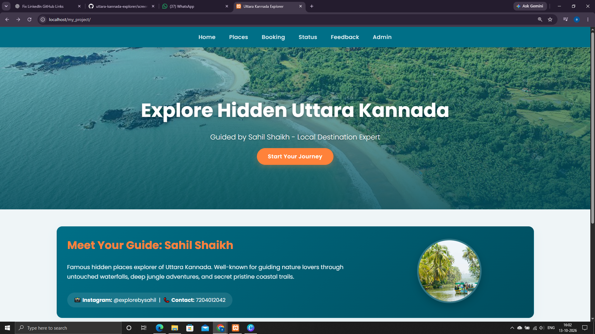
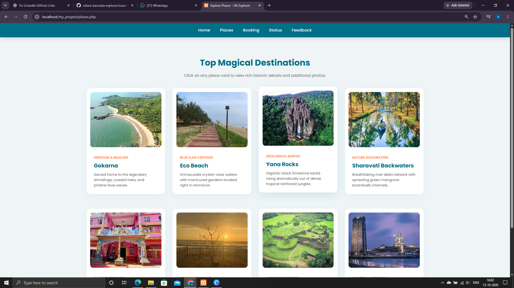
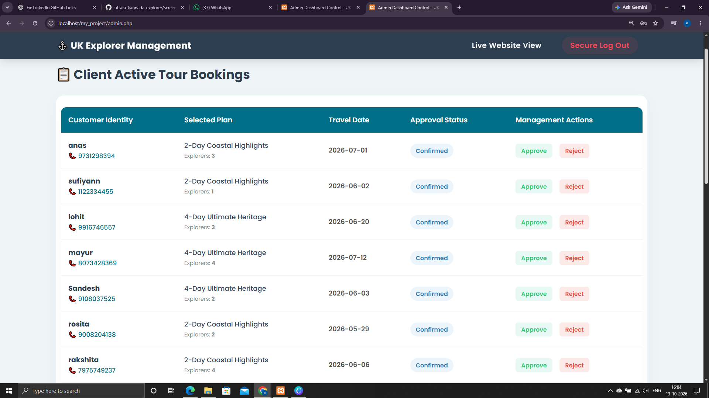
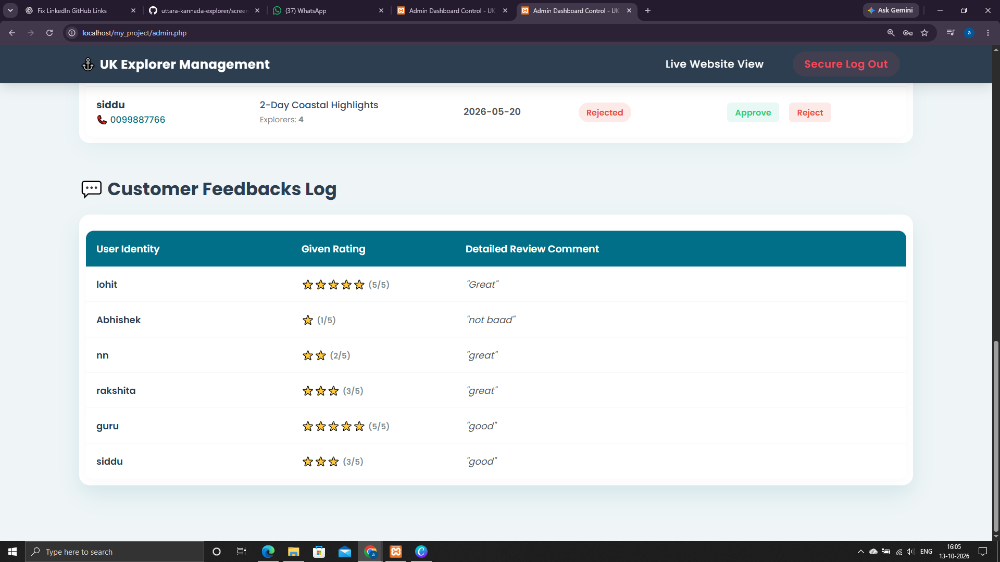
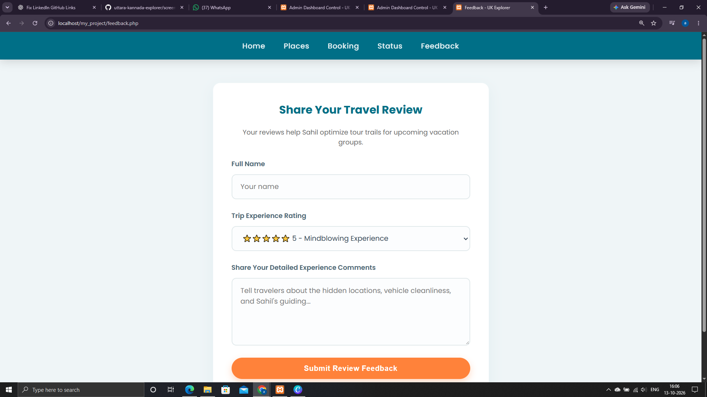
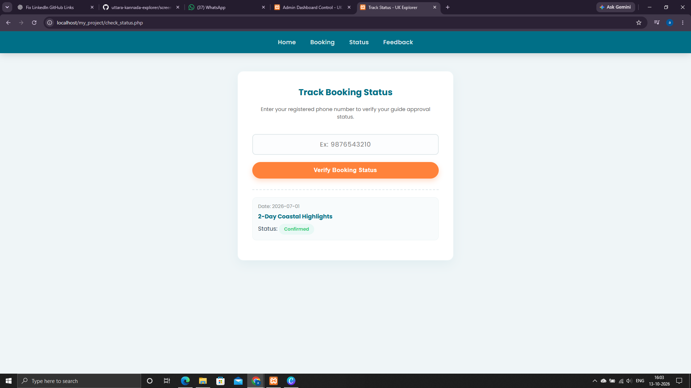

# Uttara Kannada Explorer 🌴

A tourism website showcasing the natural beauty, tourist destinations, local history, and travel experiences of Uttara Kannada, Karnataka, India.

Built as a college project using HTML, CSS, PHP, and MySQL, the website provides visitors with information about destinations, media, visitor feedback, and Sharavati backwater boating packages.

## 📸 Screenshots

### 1. Home Page

### 2. Tourist Places

### 3. Booking Page

### 4. Customer Reviews

### 5. Feedback Page

### 6. Status Page

## ✨ Features

- Explore tourist destinations in Uttara Kannada.
- View information about local attractions, history, and tourism.
- Browse destination-related images and media.
- Explore Sharavati backwater boating schedules and travel packages.
- View booking-related information.
- Customer review and feedback interfaces.
- PHP and MySQL integration for supported website functionality.

## 🛠️ Technologies Used

| Technology | Purpose |
|---|---|
| HTML5 | Website structure |
| CSS3 | Styling and layout |
| PHP | Server-side functionality |
| MySQL | Database management |

## ⚙️ Run Locally

### Prerequisites

- PHP
- MySQL or MariaDB
- A local web server such as XAMPP
- A web browser

### Setup

1. Clone or download this repository.
2. Place the project folder inside your local server's web directory (for example, `htdocs` in XAMPP).
3. Start Apache and MySQL.
4. Create the required database in phpMyAdmin.
5. Import the project's SQL file if one is included in the repository.
6. Update the database connection settings in the project configuration file.
7. Open the project in your browser using your local server address, for example:

   `http://localhost/uttara-kannada-explorer/`

**Note:** The exact database setup and configuration depend on the files included in the repository.

## 🎯 Project Objective

The objective of this project is to present Uttara Kannada's tourism destinations and travel-related information through a simple, accessible website while applying practical skills in web development and database integration.

## 📚 What I Learned

- Building web pages with HTML and CSS.
- Implementing server-side functionality using PHP.
- Working with MySQL databases.
- Organizing a multi-page website.
- Documenting a software project and presenting its interface through screenshots.

## 👨‍💻 Author

**Mohammed Sufiyan Hemakki**

- GitHub: [mohammed-sufiyan-hemakki](https://github.com/mohammed-sufiyan-hemakki)
- LinkedIn: [Mohammed Sufiyan Hemakki](https://linkedin.com/in/mohammed-sufiyan-hemakki/)

---

*Developed as a college project to showcase tourism and travel information for Uttara Kannada, Karnataka.*
